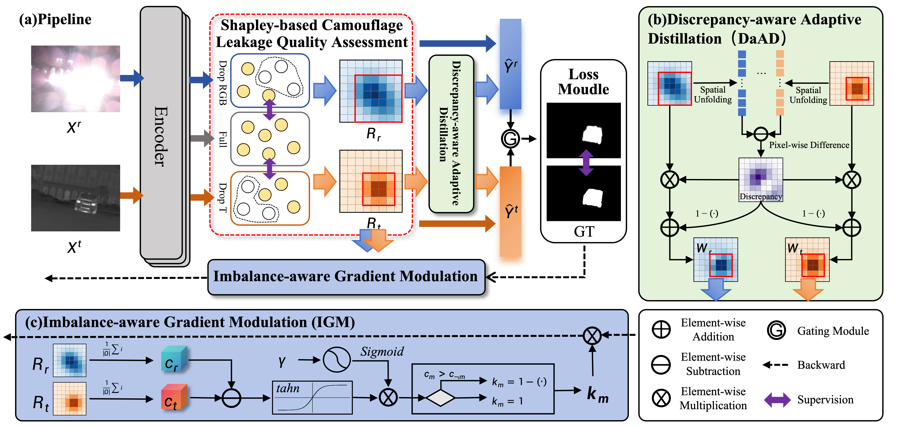
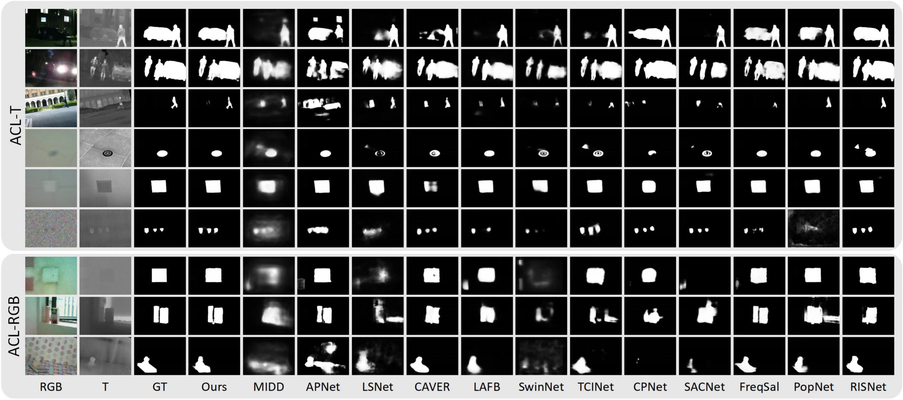

# Balancing Cross-Modal Perceptual Discrepancy: A Dynamic Optimization Framework for RGB-T Camouflaged Object Detection

This repository contains the code for an RGB-T camouflaged object detection framework. It includes training with the DaAD and IGA components, MAE evaluation, and prediction-map generation.

## Method and Results

### Network Architecture



## Requirements

The dependency versions used by this code, including PyTorch and torchvision, are listed in `requirements.txt`. Choose a Python and CUDA environment compatible with those versions, then install the dependencies:

```bash
python -m pip install -r requirements.txt
```

## Data and Checkpoint Downloads

The dataset and checkpoint files are shared separately and are not stored in this repository.

| Resource | Download | Extraction code |
|---|---|---|
| Model checkpoints | [Baidu Netdisk](https://pan.baidu.com/s/1j9AUOKEMCZeGWGD4fmlgPg) | `BCMD` |
| Test dataset | [Baidu Netdisk](https://pan.baidu.com/s/1LYqUlTdnFjnLzUqcLUN42w) | `BCMD` |

The training dataset is not included in the test-dataset download. Prepare the training and validation datasets separately.

## Training

Example command with DaAD and IGA enabled:

```bash
python train.py \
  --train_root /path/to/train_dataset/ \
  --val_root /path/to/validation_dataset/ \
  --save_path ./checkpoints/experiment \
  --use_da_ad \
  --use_da_ad_loss \
  --use_iga
```

The script saves checkpoints and a training log under `--save_path`. See `python train.py --help` for the available options.

## Testing

Example command:

```bash
python test.py \
  --pth_path ./checkpoints/Net_epoch_best.pth \
  --rgb_folder /path/to/test_dataset/RGB \
  --thermal_folder /path/to/test_dataset/T \
  --gt_folder /path/to/test_dataset/GT \
  --results_dir ./results/test_dataset
```

The script reports per-image MAE and the average MAE, and saves prediction maps to `--results_dir`. If `--results_dir` is omitted, maps are saved to the repository's `results/` directory. See `python test.py --help` for the available options.

## Quantitative Comparison

Quantitative comparison with state-of-the-art methods on the ACL-RGB and ACL-T datasets.


## Qualitative Comparison

Visual comparison of prediction maps with state-of-the-art methods on the ACL-RGB and ACL-T datasets.



## License

No license has been specified yet.
